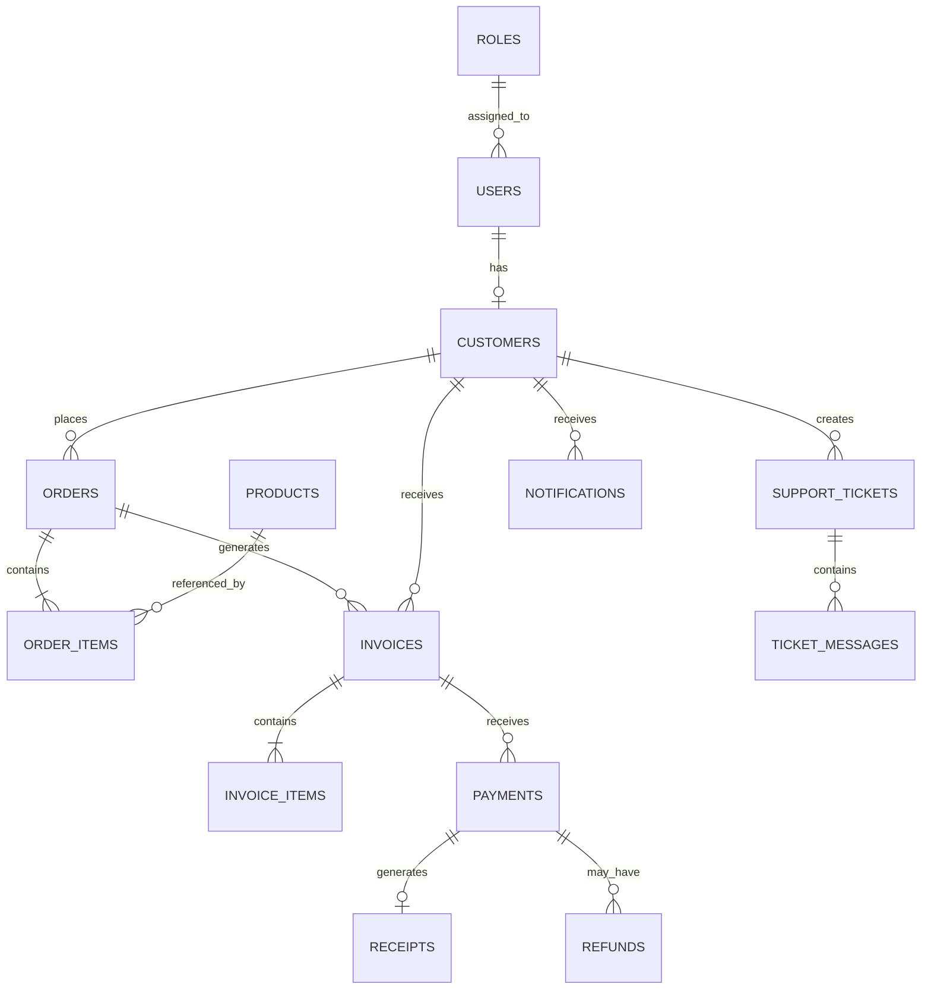
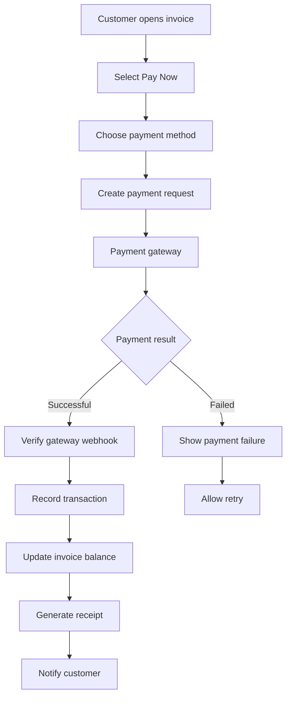
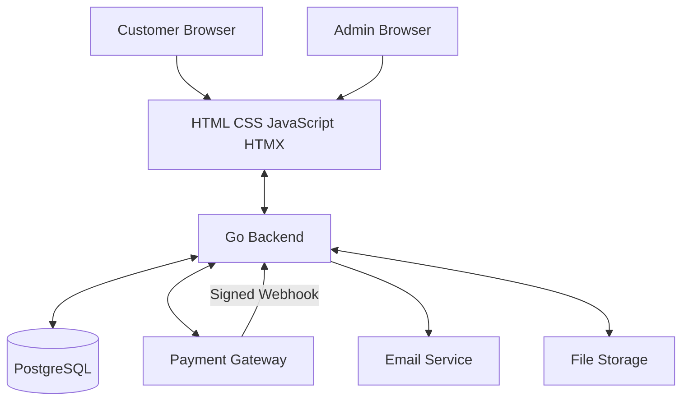

# Blank CO PH Solutions
### Self-Service Order & Invoice Management System

A self-service web application that allows customers to manage their accounts, track orders, view invoices, make payments, download receipts, and communicate with the company without needing to contact staff for every transaction.

> **Current implementation:** The customer portal is a React + TypeScript app built with Vite. It includes Supabase Auth, a Supabase client data layer, and a customer-isolated PostgreSQL schema with Row Level Security. An empty local demo workspace remains available for exploring the interface without a Supabase account.

### Run locally

```sh
npm install
npm run dev
```

### Connect Supabase

1. Copy `.env.example` to `.env`; the project URL is prefilled for `ynbnapmgnhrlugfoybbs`.
2. Set `VITE_SUPABASE_ANON_KEY` to the project's publishable/anon key. Never put a service-role key or database password in a browser app.
3. Apply `supabase/migrations/202611220001_customer_portal.sql` using the Supabase SQL editor, or run `supabase link --project-ref YOUR_PROJECT_REF` and `supabase db push` with the Supabase CLI.
4. Start the app with `npm run dev`. Use **Create an account** to register or **Sign in** for an existing account. If email confirmation is enabled in Supabase Auth, follow the confirmation link before signing in.

The app opens on the sign-in/create-account screen. **Continue to demo** is available whether or not Supabase is configured. The demo starts with an empty workspace and does not load or save sample records; demo changes last only until the page is reloaded. Older demo records stored under `blank-co-ph-solutions-demo-state` or `northstar-demo-state` are cleared automatically. Without both Supabase environment variables, account sign-up and login are disabled until Supabase is connected. Online payments are not connected, so invoices are read-only and no payment can be submitted. Authenticated users can submit order requests and support tickets, view their own invoices/payments, and update their profile. Payment creation and invoice editing are intentionally not exposed to browser clients.

The app uses a shared auth-session store to track Supabase sign-in, sign-out, and token refresh events. Supabase persists the auth session in browser storage and restores it on reload; the session store keeps React UI state synchronized with it.

### Support-ticket delivery

Support tickets are delivered to the landing-page admin inbox (`public.messages` in the `blankco-landingpage` Supabase project) as well as the customer's own ticket list. Set `VITE_INTAKE_SUPABASE_URL` and `VITE_INTAKE_SUPABASE_ANON_KEY` to that project; the checked-in `.env.example` documents both pairs. The intake anon key is a publishable value — the landing schema allows anonymous ticket inserts but only allowlisted admins can read them. The same project's `notify-ticket` Edge Function emails each new ticket to `hello@blankcoph.solutions` via Titan SMTP, so the portal gets email notifications without extra configuration.

The landing site also serves this app at `/portal/`. Its `npm run build` builds `../CPL` with `VITE_BASE_PATH=/portal/` and copies the output into `blankco-landingpage/public/portal` when both repositories are checked out side by side.

When deploying under `/portal/`, add `https://www.blankcoph.solutions/portal/` (and any preview URL) to the Supabase Auth redirect allowlist. Sign-up and email-change requests use `${window.location.origin}${import.meta.env.BASE_URL}` so confirmation links return to the embedded portal.

Amounts are displayed in Philippine pesos (PHP). Supabase invoice, order, and payment numeric amounts should be entered in PHP; changing the display currency does not perform foreign-exchange conversion.

Build and type-check with `npm run build`.

---

## Table of Contents

1. [System Overview](#1-system-overview)
2. [User Roles](#2-user-roles)
3. [System Sitemap](#3-system-sitemap)
4. [Customer Portal Modules](#4-customer-portal-modules)
5. [Admin Panel Modules](#5-admin-panel-modules)
6. [Database Structure](#6-database-structure)
7. [System Workflow](#7-system-workflow)
8. [Recommended Technology Stack](#8-recommended-technology-stack)
9. [Security Requirements](#9-security-requirements)
10. [Development Checklist](#10-development-checklist)
11. [Development Roadmap](#11-development-roadmap)

---

## 1. System Overview

The Customer Portal provides customers with a centralized place to manage orders and billing.

### Core Features

- **Order Tracking:** View orders, check their current status, and follow progress.
- **Invoice Management:** View, download, and manage invoices.
- **Online Payments:** Pay outstanding invoices using supported payment methods.
- **Payment History:** Review transactions and download receipts.
- **Customer Support:** Submit concerns and communicate with support staff.
- **Account Management:** Update personal, company, and billing information.
- **Notifications:** Receive updates about orders, invoices, payments, and support tickets.

## 2. User Roles

| Role | Responsibilities |
|---|---|
| Customer / Client | Manages their profile, orders, invoices, payments, and support requests. |
| Administrator | Manages the application, users, settings, and system-wide operations. |
| Staff / Sales Representative | Handles customer accounts and order requests. |
| Finance Staff | Creates invoices, verifies payments, and manages refunds. |
| Order Manager | Processes orders and updates order statuses. |

Access must be controlled through role-based permissions. Staff should only access the functions required for their responsibilities.

## 3. System Sitemap

### Authentication
- Login
- Register
- Forgot Password
- Reset Password
- Email Verification
- Two-Factor Authentication (optional)

### Customer Dashboard
- Dashboard Overview
- Order Summary
- Payment Summary
- Recent Activity
- Notifications

### Orders
- All Orders
- Order Details
- Track Order
- Order History
- Request New Order

### Invoices
- All Invoices
- Unpaid Invoices
- Partially Paid Invoices
- Paid Invoices
- Overdue Invoices
- Invoice Details
- Download Invoice

### Payments
- Make Payment
- Payment History
- Payment Details
- Download Receipt

### Customer Support
- Help Center
- Frequently Asked Questions
- Submit Ticket
- My Tickets
- Ticket Details

### Account
- My Profile
- Company Information
- Billing Information
- Shipping Information
- Change Password
- Security Settings
- Notification Preferences

### Other
- Notifications
- Announcements
- Documents
- Settings

---

## 4. Customer Portal Modules

### 4.1 Authentication Module

| Component | Description |
|---|---|
| Login Form | Authenticate using email and password. |
| Registration Form | Create a customer account. |
| Forgot Password | Request a password reset. |
| Reset Password | Set a new password. |
| Email Verification | Verify the registered email address. |
| Remember Me | Optionally maintain a login session. |
| Password Visibility | Show or hide password input. |
| CAPTCHA | Help prevent automated abuse. |
| Two-Factor Authentication | Add an extra authentication step. |
| Logout | End the current session. |

### 4.2 Customer Dashboard

The dashboard is the main landing page after a customer logs in.

**Dashboard components:**
- Welcome header and customer name
- Total Orders card
- Active Orders card
- Completed Orders card
- Unpaid Invoices card
- Total Amount Due
- Total Payments card
- Recent Orders table
- Upcoming Payment reminders
- Recent Transactions
- Order Status Chart
- Notifications Panel
- Quick Actions:
  - Track Order
  - View Invoices
  - Pay Invoice
  - Contact Support

### 4.3 Order Management Module

#### All Orders Page

**Components:**
- Search orders
- Filter by order status
- Filter by date
- Filter by order number
- Sort orders
- Orders table
- Pagination
- Export order history

**Suggested table columns:**

| Column | Description |
|---|---|
| Order ID | Unique order number. |
| Order Date | Date the order was created. |
| Product / Service | Ordered item or service. |
| Quantity | Number of items. |
| Total Amount | Total order amount. |
| Status | Current order status. |
| Payment Status | Payment state. |
| Actions | View or track order. |

#### Order Details Page

- Order reference number
- Customer information
- Product/service information
- Order quantity
- Unit price and order total
- Discounts and taxes
- Order notes
- Attached documents
- Payment information
- Current order status
- Estimated completion date

#### Order Tracking

Display order progress using a timeline.

Recommended order statuses:

1. Pending
2. Confirmed
3. Processing
4. Ready for Delivery
5. Shipped
6. Delivered
7. Completed
8. Cancelled
9. On Hold

Record every status change with its timestamp and the staff member or system action responsible.

### 4.4 Invoice Management Module

#### Invoice List

- Invoice number
- Invoice date
- Due date
- Related order reference
- Total amount
- Amount paid
- Remaining balance
- Invoice status
- View invoice action
- Download PDF action
- Pay Now action

#### Invoice Statuses

| Status | Meaning |
|---|---|
| Draft | Invoice has not been issued. |
| Unpaid | Awaiting payment. |
| Partially Paid | Some amount has been paid. |
| Paid | Fully paid. |
| Overdue | Payment deadline has passed and a balance remains. |
| Cancelled | Invoice has been cancelled. |
| Refunded | Payment has been refunded, subject to refund records. |

#### Invoice Details

- Company logo and information
- Invoice number
- Customer billing information
- Invoice date and due date
- Itemized products/services
- Quantity and unit price
- Subtotal
- Discount
- Tax
- Total amount
- Amount paid
- Remaining balance
- Payment instructions
- Download invoice
- Print invoice
- Pay invoice

### 4.5 Payment Management Module

#### Payment Components

1. Pay Now button
2. Invoice selection
3. Payment amount
4. Payment method selection
5. Payment confirmation
6. Payment processing screen
7. Payment success screen
8. Payment failure screen
9. Payment history
10. Digital receipt
11. Refund status

#### Suggested Payment Methods

For a Philippine-based deployment:

- GCash
- Maya
- Online banking
- Credit / Debit Card
- Bank Transfer
- Manual payment verification

Possible payment gateway integrations:
- [PayMongo](https://www.paymongo.com/)
- [Xendit](https://www.xendit.co/)

#### Payment Requirements

- Secure payment processing
- Payment gateway callback/webhook handling
- Transaction reference number
- Automatic invoice balance updates
- Duplicate payment prevention
- Payment verification
- Refund tracking
- Downloadable receipts

**Security note:** Never store raw card numbers, CVVs, or payment passwords in the application database. Use a compliant payment gateway and store only the necessary transaction references and payment metadata.

### 4.6 Customer Profile & Account Settings

- Profile picture
- Full name
- Email address
- Contact number
- Company name
- Business address
- Billing address
- Shipping address
- Edit profile
- Change password
- Change email
- Notification preferences
- Security settings
- Active sessions
- Logout

### 4.7 Notifications Module

#### Notification Types

- Order created
- Order confirmed
- Order status changed
- Order completed
- New invoice generated
- Invoice due reminder
- Invoice overdue
- Payment successful
- Payment failed
- Payment verified
- Support ticket response
- Company announcement

#### Components

- Notification icon
- Unread notification counter
- Notification dropdown
- Notification center
- Mark as read
- Mark all as read
- Delete notification
- Notification preferences

### 4.8 Customer Support Module

- Help Center
- Frequently Asked Questions
- Create support ticket
- Ticket category
- Ticket priority
- Ticket description
- File attachments
- Ticket status
- Conversation history
- Staff replies
- Close ticket
- Reopen ticket

Recommended ticket statuses:

- Open
- In Progress
- Waiting for Customer
- Resolved
- Closed

---

## 5. Admin Panel Modules

The admin panel is a separate interface connected to the same backend and database. It is used by administrators and authorized staff to manage business operations.

### 5.1 Admin Dashboard

- Total registered customers
- Total orders
- Pending orders
- Processing orders
- Completed orders
- Total revenue
- Outstanding invoices
- Overdue invoices
- Total payments
- Recent transactions
- Revenue chart
- Order statistics
- Recent customer activities

### 5.2 Customer Management

- Customer list
- Add customer
- Edit customer
- View customer profile
- Customer order history
- Customer payment history
- Customer invoice history
- Activate/deactivate account
- Reset customer password through a secure process
- Assign customer representative

### 5.3 Order Administration

- View all orders
- Create order for customer
- Edit order
- Approve/reject orders
- Assign order handler
- Update order status
- Add internal notes
- Upload order documents
- Generate invoice
- Cancel order
- View order history

### 5.4 Invoice Administration

- Create invoice
- Generate invoice number
- Assign invoice to customer
- Link invoice to order
- Add products/services
- Add taxes and discounts
- Set payment due date
- Edit draft invoice
- Issue/send invoice
- Download PDF
- Cancel invoice
- Record manual payments
- Manage overdue invoices

Issued invoices should have controlled editing. Preserve an audit trail and use adjustments or credit notes when changing financial records.

### 5.5 Payment Administration

- View all payments
- View transaction details
- Verify manual payments
- Approve/reject payment verification
- Process or record refunds
- View payment gateway transactions
- Manage failed payments
- Export payment reports

### 5.6 Staff & Role Management

- Add staff account
- Edit staff profile
- Assign roles
- Set permissions
- Activate/deactivate staff
- Secure password reset
- View staff activities

### 5.7 Reports & Analytics

- Sales report
- Revenue report
- Order report
- Customer report
- Invoice report
- Payment report
- Overdue invoice report
- Monthly revenue
- Yearly revenue
- Export PDF / Excel / CSV

### 5.8 System Settings

- Company information
- Company logo
- Invoice configuration
- Order configuration
- Tax configuration
- Payment gateway configuration
- Email settings
- Notification settings
- User permissions
- Audit logs
- Backup settings

---

## 6. Database Structure

**Recommended database:** PostgreSQL or Supabase PostgreSQL.

### Core Tables

| Table | Purpose |
|---|---|
| `users` | Login accounts and user information. |
| `roles` | Admin, staff, finance, and customer roles. |
| `permissions` | Individual access permissions. |
| `user_roles` | User role assignments, if multiple roles are supported. |
| `customers` | Customer profile information. |
| `addresses` | Billing and shipping addresses. |
| `products` | Products or services. |
| `orders` | Customer orders. |
| `order_items` | Individual products/services in an order. |
| `order_status_history` | Order status changes. |
| `invoices` | Invoice records. |
| `invoice_items` | Invoice line items. |
| `payments` | Payment records. |
| `payment_methods` | Supported payment methods. |
| `payment_transactions` | Gateway transaction references. |
| `payment_verifications` | Manual payment verification records. |
| `receipts` | Payment receipts. |
| `refunds` | Refund records. |
| `notifications` | Customer notifications. |
| `support_tickets` | Customer support requests. |
| `ticket_messages` | Support ticket conversations. |
| `attachments` | Uploaded documents and files. |
| `announcements` | Company announcements. |
| `audit_logs` | Important system activity records. |
| `system_settings` | Application configuration. |

### Entity Relationship Diagram



### Database Design Notes

- A customer can have multiple orders.
- An order can contain multiple order items.
- An order can generate one or more invoices, depending on the business process.
- An invoice can receive multiple payments to support partial payments.
- A payment can have one or more refund records, depending on the refund model.
- A successful payment can generate a receipt.
- A customer can create multiple support tickets.
- A support ticket can contain multiple messages.
- Record timestamps for important business events.
- Use foreign keys, unique constraints, and appropriate indexes.
- Store money using `NUMERIC`/`DECIMAL`, not floating-point types.
- Store financial transaction history rather than relying only on a mutable balance field.

---

## 7. System Workflow

### Customer Order-to-Payment Workflow

1. **Customer Registration** — Customer creates an account and verifies their email.
2. **Customer Places an Order** — Customer submits an order or service request.
3. **Admin Reviews Order** — Staff approves, rejects, or requests additional information.
4. **Order Processing** — The order manager updates progress and status.
5. **Invoice Generation** — Finance staff generates an invoice linked to the order.
6. **Customer Notification** — Customer is notified that an invoice is available.
7. **Customer Makes Payment** — Customer pays through an available payment method.
8. **Payment Verification** — A verified gateway webhook or authorized finance staff confirms the payment.
9. **Receipt Generation** — The system generates a digital receipt and updates the invoice balance.
10. **Order Completion** — Customer tracks the final order status and views transaction history.

### Payment Processing Flow



**Important:** Do not mark an invoice as paid based only on the customer's browser redirect or success screen. Verify the payment server-side using the gateway's signed webhook or transaction verification API. Make webhook processing idempotent to prevent duplicate payment records.

---

## 8. Recommended Technology Stack

The current MVP uses React + TypeScript + Vite with Supabase Auth and PostgreSQL. For a future production backend, the stack below remains an alternative server-rendered architecture; select one application architecture rather than mixing both.

| Layer | Technology | Purpose |
|---|---|---|
| Frontend (current MVP) | React + TypeScript + Vite | Customer portal UI |
| Styling | CSS3 | Responsive design and UI |
| Backend (current MVP) | Supabase Auth + PostgREST | Authentication and customer-scoped data access |
| Database | Supabase PostgreSQL | Persistent application data with Row Level Security |
| Alternative backend | Go (Golang) | Business logic and REST/API endpoints |
| Database Hosting | Supabase | Managed PostgreSQL and related services |
| Payments | PayMongo / Xendit | Online payment processing |
| Email | SMTP / Resend | Transactional emails |
| File Storage | Supabase Storage / Cloudinary | Document storage |
| Caching | Redis (optional) | Caching and background-job support |
| Documents | Go PDF library | Invoice and receipt generation |

### Suggested Architecture



The customer portal and admin panel should be separate interfaces connected to one backend and database. This avoids duplicated business logic and simplifies maintenance.

---

## 9. Security Requirements

Because the application handles customer information and financial transactions, security must be included from the beginning.

| Security Feature | Purpose |
|---|---|
| Authentication | Secure account login. |
| Role-Based Access Control | Restrict access by role and permission. |
| Password Hashing | Protect stored passwords using a modern password-hashing algorithm. |
| HTTPS | Encrypt network communication. |
| Database Access Policies | Prevent unauthorized data access. |
| Input Validation | Reject invalid submissions. |
| SQL Injection Protection | Use parameterized queries. |
| XSS Protection | Prevent malicious scripts. |
| CSRF Protection | Protect state-changing browser requests. |
| Rate Limiting | Reduce brute-force and automated abuse. |
| Audit Logs | Track sensitive actions. |
| Secure File Uploads | Validate file type, size, and access. |
| Payment Webhooks | Verify gateway payment events. |
| Session Management | Secure and expire user sessions. |
| Backup and Recovery | Protect business records. |

### Additional Security Guidelines

- Enforce customer ownership checks on every order, invoice, payment, and ticket request.
- Never trust customer-supplied prices, totals, payment statuses, or role values.
- Calculate financial totals on the server.
- Keep payment gateway secrets in environment variables or a secrets manager.
- Verify webhook signatures.
- Make payment and webhook operations idempotent.
- Restrict access to uploaded files.
- Log important administrative and financial changes.
- Avoid exposing sensitive information in application logs.

---

## 10. Development Checklist

Use this checklist to track implementation progress.

### Authentication
- [ ] Login and registration
- [ ] Email verification
- [ ] Forgot/reset password
- [ ] Role-based authentication
- [ ] Session management

### Customer Dashboard
- [ ] Dashboard overview
- [ ] Order statistics
- [ ] Invoice statistics
- [ ] Recent transactions
- [ ] Notifications

### Order Management
- [ ] Create order/request
- [ ] Order list and search
- [ ] Order details
- [ ] Order tracking timeline
- [ ] Order status notifications
- [ ] Order history

### Invoice Management
- [ ] Create and generate invoice
- [ ] Invoice list
- [ ] Invoice details
- [ ] PDF invoice generation
- [ ] Invoice due-date tracking
- [ ] Partial payment support
- [ ] Overdue invoice management

### Payment Management
- [ ] Payment gateway integration
- [ ] Payment checkout
- [ ] Payment confirmation
- [ ] Webhook verification
- [ ] Payment history
- [ ] Digital receipts
- [ ] Refund management

### Customer Account
- [ ] Customer profile
- [ ] Company information
- [ ] Billing and shipping addresses
- [ ] Password management
- [ ] Security settings

### Customer Support
- [ ] Help center and FAQs
- [ ] Create support tickets
- [ ] Ticket conversations
- [ ] File attachments
- [ ] Ticket status management

### Admin Panel
- [ ] Admin dashboard
- [ ] Customer management
- [ ] Staff and roles
- [ ] Order administration
- [ ] Invoice administration
- [ ] Payment verification
- [ ] Reports and analytics
- [ ] System settings

### Security and Deployment
- [ ] Database access control
- [ ] Input validation
- [ ] Audit logging
- [ ] HTTPS and secure cookies
- [ ] Database backup
- [ ] Error handling
- [ ] Responsive mobile design
- [ ] Production deployment

---

## 11. Development Roadmap

Build the system in phases rather than implementing every module at once.

| Phase | Modules | Priority |
|---|---|---|
| 1 | Database, authentication, and roles | Critical |
| 2 | Customer dashboard and profiles | High |
| 3 | Order management and tracking | High |
| 4 | Invoice management and PDF generation | High |
| 5 | Payment gateway and receipts | High |
| 6 | Notifications and email | Medium |
| 7 | Admin reports and analytics | Medium |
| 8 | Support tickets and announcements | Medium |
| 9 | Security hardening, testing, and deployment | Critical |

### Recommended MVP

For the first working release, prioritize:

1. Customer registration and login
2. Customer dashboard
3. Customer and staff management
4. Order creation and tracking
5. Invoice creation and viewing
6. Payment integration or verified manual payments
7. Payment history and receipts
8. Basic notifications
9. Admin dashboard

Additional features such as advanced analytics, support ticket automation, and announcements can be introduced in later releases.

---

## Project Goal

The main goal of the Customer Portal is to centralize the customer lifecycle:

**Customers → Orders → Invoices → Payments → Receipts**

Every transaction should be traceable from the original customer order to its final payment. Customers should be able to access their information independently, while authorized staff manage operations through the admin panel.
